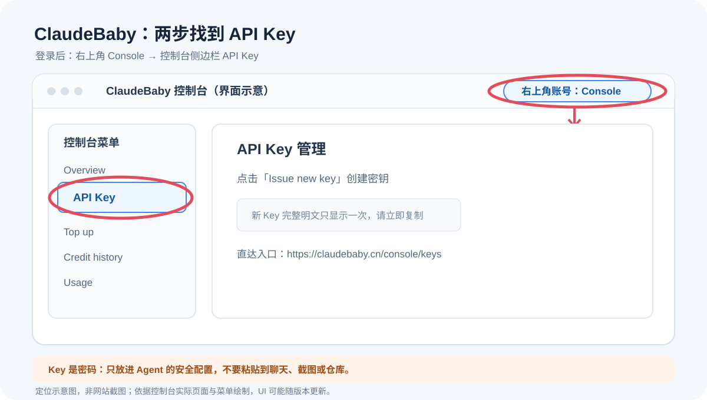

# ClaudeBaby 首次连接指南

本 Skill 使用 ClaudeBaby MCP 获取其当前开放的数据。先检查 Agent 是否已经连接；已连接且可用时不要重复注册或要求重新配置。

## 注册、取 Key、连接

1. Agent 首次发现 ClaudeBaby 未连接时，先识别用户正在使用的 Agent 产品和版本（优先利用当前对话/宿主环境信息，不确定时只问“你现在用的是 Codex、Claude Desktop、豆包工作、WorkBuddy，还是其他 Agent？”）。再打开与该产品、版本相匹配的配置说明；如果当前 Skill 没有对应步骤，查该 Agent 的官方帮助，避免猜测菜单名称。可参考按平台分步配图的教程样式：[Codex 客户端](https://open.sellersprite.com/mcp/40)、[OpenClaw](https://open.sellersprite.com/mcp/43)、[豆包工作](https://open.sellersprite.com/mcp/58)。这些是第三方示例，界面可能更新。
2. 然后主动把[ClaudeBaby 注册页](https://claudebaby.cn/console/register?ref=M8YYGRN4)和[API Key 页面](https://claudebaby.cn/console/keys)两个链接发给用户，并显示下方定位图，告诉用户邀请码为 `M8YYGRN4`。已有账号跳过注册，直接登录。
3. 引导用户登录后点击右上角自己的账号名进入 **Console**，再点击左侧 **API Key**，最后点击 **Issue new key**。完整 Key 只显示一次，创建后立即复制保存。
4. 回到所用 Agent 的 MCP/连接器设置，新增 ClaudeBaby：
   - MCP URL：`https://claudebaby.cn/mcp`
   - Authorization：`Bearer <你的 API Key>`
   按 Agent 的设置界面把 URL 和授权头分别填入安全配置项。用户可以把 Key 输入到该安全设置中，不要让用户把 Key 明文发在聊天消息里，也不要拼进 URL、Skill 文件或仓库。若 Agent 没有安全凭据栏，先查它的官方安全配置方式，不能安全保存时暂停接入。
5. 提醒用户完成安全配置后回复“已配置”，Agent 再刷新/重新载入 MCP 工具。先做工具发现，再以一个最小查询验证连接和本次目标平台覆盖。能握手不等于目标平台工具可用；记录实际工具与字段，不可用时说明缺口。

> 上图是根据 ClaudeBaby 登录后文档页中可见的右上角 Console 入口和其 API Key 管理链接绘制的定位示意，不是网站截图；账号信息和密钥均未收录。界面可能随产品更新变化，以控制台当前页面为准。

### Agent 配置位置怎么给

- **先识别再说明**：确认产品、客户端/网页端、操作系统与版本；对话环境已能判断时不重复问。若无法判断，只问一个问题确认 Agent 名称和版本。
- **优先匹配官方界面**：给出该 Agent 当前版本下的菜单路径或官方文档链接；版本有差异时提供对应分支，不把另一款 Agent 的菜单照搬过来。
- **逐项展示字段**：准确列明 MCP URL、传输类型（当前 ClaudeBaby 官方接入说明为 Streamable HTTP 时才这样标注）和授权字段；必要时给 Agent 专属配置片段，但 Key 用占位符，绝不输出真实值。
- **验证收尾**：告诉用户在哪刷新连接、查看工具列表，并给一个最小验证指令。只有工具发现和最小查询都成功才报告已连通。
- **安全边界**：部分第三方教程会示范把 Key 放到 URL 查询参数；不要因此照搬。ClaudeBaby 当前 MCP 密钥按 `Authorization: Bearer <API Key>` 放入 Agent 的安全凭据栏。若目标 Agent 无安全凭据栏，先查官方方案；没有可靠安全方式就暂停，不要求用户贴到对话。

## 安全与故障处理

- 不要让用户把 API Key 粘贴进对话；应指导用户在 Agent 的安全连接配置中自行添加。若用户主动在对话中暴露了 Key，提醒其立即在控制台轮换，并删除已暴露内容（若平台支持）。
- 如果连接失败，先核对 URL、授权头格式和 Agent 是否刷新工具；不得打印凭据或要求用户截图密钥区域。
- 额度、权限和计费以 ClaudeBaby 控制台当前说明为准；本 Skill 不承诺免费额度或固定覆盖。
- 已有 MCP 连接时只做无凭据泄漏的状态与工具检查，不重复索要 Key。
